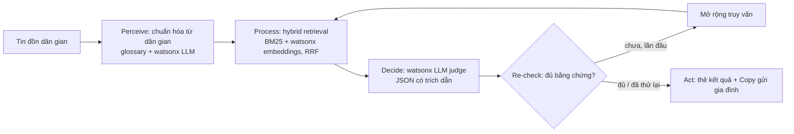

# Healthcare-PBM-AI: kiểm chứng tin sức khỏe tiếng Việt cho người cao tuổi

Agent RAG trên **IBM watsonx.ai**, được xây dựng cùng **IBM Bob**. Người dùng dán một tin nhận được trên Zalo/Facebook (viết bằng cách nói dân gian), hệ thống trả về thẻ kết quả **Đúng / Sai / Gây hiểu lầm / Chưa đủ bằng chứng**, kèm giải thích 2 câu, nguồn Bộ Y tế/WHO và một tin nhắn lịch sự để con cháu gửi lại cho bố mẹ.

## Vấn đề
- Người trung niên và cao tuổi là nạn nhân chính của tin giả sức khỏe: một cụ gần 70 tuổi bỏ viện theo video "nhịn ăn, tắm nắng 7 ngày chữa ung thư"; một bà 69 tuổi ngồi xe lăn sau nhiều năm dùng thuốc gia truyền trộn corticoid (VietNamNet, 07–08/2025).
- Người trên 65 tuổi chia sẻ link tin giả nhiều hơn: 11% so với 3% ở nhóm 18–29 (Guess, Nagler & Tucker, *Science Advances*, 2019).
- Con cháu thấy nhưng hiếm khi lên tiếng: chỉ 16,2% người trẻ Việt Nam chủ động ngăn tin giả (*Scientific Reports*, 2025).

## Enterprise Design Thinking
**Problem statement:** Người Việt trung niên và cao tuổi khó phân biệt tin sức khỏe thật giả trên Facebook và Zalo, vì tin giả dùng đúng cách nói dân gian quen thuộc, còn nguồn chính thống dài, khó tìm và dùng thuật ngữ y khoa.

**Hill:** *Who* bà Hoa (66) và cháu Minh (24) · *What* dán một tin và trong vài giây biết đúng/sai kèm nguồn, bằng chính cách nói của mình · *Wow* độ chính xác, độ trễ và chi phí đo trên bộ eval (bảng dưới), mọi kết luận đều có nguồn.

**As-is → To-be:** bà Hoa nhận video và chuyển tiếp; Minh ngại đính chính → Minh dán tin vào tool, thấy "Sai" + "Đã hiểu: tai biến → đột quỵ", bấm *Copy gửi gia đình* và gửi vào nhóm Zalo.

## Kiến trúc (goal-based agent, 5 bước RAG)

RAG: (1) prompt creation = claim đã chuẩn hóa · (2) information search = BM25 + vector · (3) retrieval = top-5 đoạn · (4) prompt augmentation = ghép đoạn nguồn vào prompt judge · (5) response generation = verdict JSON có trích dẫn.

| Thành phần IBM | Vai trò |
|---|---|
| IBM Bob | Lập kế hoạch, viết và review code (Plan / Agent / Ask mode, checkpoints) |
| watsonx.ai LLM (`WATSONX_MODEL_ID`) | Chuẩn hóa claim, ra verdict có trích dẫn |
| watsonx.ai embeddings (`WATSONX_EMBED_MODEL_ID`) | Tìm kiếm ngữ nghĩa tiếng Việt |
| Roadmap: Granite Guardian, watsonx Orchestrate, Code Engine, watsonx.data | Kiểm tra groundedness, điều phối nhiều agent, deploy, kho nguồn quy mô lớn |

## Kết quả (ablation)
Mỗi cải tiến bật bằng flag và đo lại trên cùng bộ claim gán nhãn tay (`data/eval_claims.jsonl`). Bảng đầy đủ: [`eval/ablation.md`](eval/ablation.md).

| Variant | Accuracy | Recall@5 | p50 latency | Cost/request |
|---|---|---|---|---|
| baseline (dense) | _ | _ | _ | _ |
| + hybrid | _ | _ | _ | _ |
| + folk normalization | _ | _ | _ | _ |
| + agent retry (full) | _ | _ | _ | _ |

## Chạy thử
```bash
python3 -m venv .venv && source .venv/bin/activate
pip install -r requirements.txt
cp .env.example .env            # điền WATSONX_APIKEY, WATSONX_PROJECT_ID (để trống = chế độ offline)
python scripts/smoke_test.py    # kiểm tra kết nối watsonx
python -m src.ingest            # đọc data/sources/*.md, tạo index/
python -m eval.run_eval --variant baseline
python -m eval.run_eval --variant hybrid --flags hybrid
python -m eval.run_eval --variant hybrid+folk --flags hybrid,folk
python -m eval.run_eval --variant full --flags hybrid,folk,agent
streamlit run app.py
```
Không có khóa watsonx, hệ thống tự chạy **chế độ offline** (embedding băm cục bộ + judge theo luật), giao diện ghi rõ điều này. Số liệu báo cáo phải lấy từ chế độ watsonx.

## Guardrails và giới hạn
- Không có trích dẫn thì không kết luận: trả "Chưa đủ bằng chứng".
- Agent thử tìm lại một lần, sau đó từ chối thay vì đoán.
- Cờ `see_doctor` hiện "Nên đi khám ngay" với đột quỵ, ung thư, sốt xuất huyết...; luôn có cảnh báo "không thay thế bác sĩ".
- `.env` không bao giờ được commit; `.bobignore` giữ khóa và dữ liệu ngoài ngữ cảnh của Bob.
- Giới hạn: bộ eval nhỏ, chưa có bác sĩ duyệt; số liệu tuổi 11% vs 3% là của Mỹ; chỉ phủ các chủ đề có trong `data/sources/`.

## Built with IBM Bob
Quy trình: Plan mode dựng khung → Agent mode viết từng thành phần → Ask mode giải thích lỗi trước khi sửa → checkpoints để quay lại → review trước khi nộp. Luật dự án ngắn trong [`agents.md`](agents.md); [`.bobignore`](.bobignore) chặn `.env`, dữ liệu nguồn và index. Báo cáo phiên Bob: [`docs/bob-sessions/`](docs/bob-sessions/). Bài viết nộp: [`docs/SUBMISSION-STATEMENTS.md`](docs/SUBMISSION-STATEMENTS.md).

## Roadmap
Zalo bot cho người cao tuổi; watsonx Orchestrate điều phối agent chuẩn hóa / tìm nguồn / kiểm tra an toàn; Granite Guardian; 5 Sponsor User trên 60 tuổi dùng thử 2 tuần; thêm chủ đề chỉ cần thêm file nguồn và glossary.
