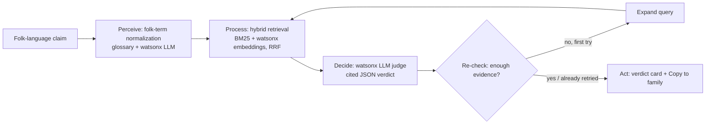

# Healthcare-PBM-AI: Vietnamese health-claim fact-checker for older adults

An agentic RAG system on **IBM watsonx.ai**, built with **IBM Bob**. A user pastes a message they received on Zalo or Facebook, written in everyday folk language. The system returns a verdict card (**True / False / Misleading / Not enough evidence**) with a two-sentence explanation in plain Vietnamese, a Ministry of Health / WHO source, and a polite message younger relatives can forward to their parents.

## Problem
- Middle-aged and older adults are the main victims of health misinformation in Vietnam. A man of nearly 70 refused hospital care to follow a "7-day fasting and sunbathing cure" for suspected cancer; a 69-year-old woman ended up in a wheelchair after years of a "family remedy" laced with corticosteroids (VietNamNet, July–August 2025).
- Older users share fake news more: 11% of users over 65 vs 3% of users aged 18–29 (Guess, Nagler & Tucker, *Science Advances*, 2019).
- Younger relatives rarely push back: only 16.2% of young Vietnamese act to stop fake news (*Scientific Reports*, 2025).

## Enterprise Design Thinking
**Problem statement:** Older Vietnamese adults struggle to tell true from false health claims on Facebook and Zalo, because misinformation uses the folk phrasing they know, while official sources are long, hard to find and written in clinical terms.

**Hill:** *Who* Mrs. Hoa (66) and her grandson Minh (24) · *What* paste a message and, within seconds, know whether it is true, with a source, in their own words · *Wow* accuracy, latency and cost measured on a labelled eval set (below); every verdict is cited.

**As-is → To-be:** Mrs. Hoa receives a video and forwards it; Minh avoids correcting her → Minh pastes the message into the tool, sees "False" plus "Understood: tai biến → đột quỵ (stroke)", taps *Copy to family* and sends it to the family Zalo group.

## Architecture (goal-based agent, 5-step RAG)

RAG steps: (1) prompt creation = normalized claim · (2) information search = BM25 + vectors · (3) retrieval = top-5 chunks · (4) prompt augmentation = source chunks inserted into the judge prompt · (5) response generation = cited JSON verdict.

| IBM component | Role |
|---|---|
| IBM Bob | Code review (/review) and safety fix (see Known issues) |
| watsonx.ai LLM (`WATSONX_MODEL_ID`) | Claim normalization and cited verdicts |
| watsonx.ai embeddings (`WATSONX_EMBED_MODEL_ID`) | Semantic search in Vietnamese |
| Roadmap: Granite Guardian, watsonx Orchestrate, Code Engine, watsonx.data | Groundedness checks, multi-agent coordination, deployment, large-scale source library |

## Results (ablation)
Every improvement is behind a feature flag and measured on the same hand-labelled claims (`data/eval_claims.jsonl`, 20 claims across 10 topics). `eval/run_eval.py` appends each run to [`eval/ablation.md`](eval/ablation.md).

| Variant | Flags | Accuracy | Recall@5 |
|---|---|---|---|
| baseline | — | 85% | 100% |
| hybrid | hybrid | 85% | 100% |
| hybrid+folk | hybrid, folk | 85% | 100% |
| hybrid+folk+agent | hybrid, folk, agent | 85% | 100% |

Accuracy and Recall@5 are identical across variants because all runs use **offline mode** (local hashing embeddings + rule-based judge). The 3 misclassifications are `gay_hieu_lam` claims predicted as `dung` or `sai` — a known gap in the offline rule judge. The retrieval and folk-normalisation flags are expected to show differentiated lift once the watsonx LLM path is active. Full per-claim breakdowns are in [`eval/ablation.md`](eval/ablation.md).

## Run it
```bash
python3 -m venv .venv && source .venv/bin/activate
pip install -r requirements.txt
cp .env.example .env            # set WATSONX_APIKEY, WATSONX_PROJECT_ID (leave empty = offline mode)
python scripts/smoke_test.py    # check the watsonx connection
python -m src.ingest            # read data/sources/*.md and build index/
python -m eval.run_eval --variant baseline
python -m eval.run_eval --variant hybrid --flags hybrid
python -m eval.run_eval --variant hybrid+folk --flags hybrid,folk
python -m eval.run_eval --variant full --flags hybrid,folk,agent
streamlit run app.py
```
Without a watsonx key the system runs in **offline mode** (local hashed embeddings + a rule-based judge), and the UI says so clearly.

> **Demo status (2026-11-22):** the watsonx.ai path (LLM + embeddings) is fully implemented in `src/watsonx_client.py`, but it has not been run: IBM Cloud returned *"An error occurred while retrieving data from global catalog"* when we tried to create the watsonx.ai Runtime service (twice). The demo video and the numbers above therefore use **offline mode**. With a key, only `.env` needs to change; no code changes.

## Known issues (found by IBM Bob /review)
Bob reviewed `src/judge.py` and `src/graph.py` and reported five issues. Bob fixed #1, #2, and #3. The rest are open:
1. ~~`judge.py`: chunk indices in the judge prompt are 0-based but the prompt does not say so; if the LLM answers with 1-based indices, valid citations are dropped and the guardrail returns "Not enough evidence".~~ (fixed by Bob — indices are now auto-shifted).
2. ~~`judge.py`: `_not_enough` always set `see_doctor=False`~~ (fixed by Bob).
3. ~~`graph.py`: if a node fails before the judge writes `verdict`, `state["verdict"]` is missing and the final step crashes with no recovery path.~~ (fixed by Bob — `_run_plain` fallback + safe `state.get`).
4. `graph.py`: the compiled LangGraph app is a module-level singleton; a runtime `ImportError` inside `invoke` is never caught by the plain-Python fallback.
5. `judge.py`: the JSON retry reuses the identical prompt, so at temperature 0 it is a wasted call; it should add a "return valid JSON only" correction.

## Guardrails and limitations
- No citation, no conclusion: the system answers "Not enough evidence".
- The agent retries retrieval once, then declines instead of guessing.
- A `see_doctor` flag shows "See a doctor now" for stroke, cancer, dengue and similar; a "does not replace a doctor" warning is always shown.
- `.env` is never committed; `.bobignore` keeps keys and data out of Bob's context.
- Limitations: small eval set with no clinician review; the 11% vs 3% age figures are from the US; only topics in `data/sources/` are covered. Source files are short Vietnamese summaries of the linked WHO/NHS pages.

## How we built it
Claude Code (Anthropic) planned the project and wrote the first working version. IBM Bob then reviewed the judge and agent graph (/review, five issues found, listed under Known issues) and fixed the most safety-critical one in Code mode. Project rules for Bob are in [`agents.md`](agents.md); [`.bobignore`](.bobignore) blocks `.env`, source data and the index. Bob session reports: [`docs/bob-sessions/`](docs/bob-sessions/). Submission statements: [`docs/SUBMISSION-STATEMENTS.md`](docs/SUBMISSION-STATEMENTS.md).

## Roadmap
A Zalo bot for older users; watsonx Orchestrate to coordinate normalization / retrieval / safety agents; Granite Guardian; a two-week pilot with five Sponsor Users over 60; new topics only need new source files and glossary entries.
